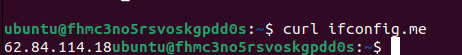
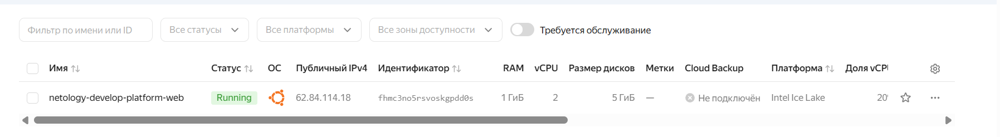

# netology_terraform_basics
Домашнее задание к занятию «Основы Terraform. Yandex Cloud»

# Задача 1
Созданная ВМ:




Что касается возникших ошибок:
* Проблема с версией Терраформ, которая была ограничена ```required_version = "~>1.12.0"``` (то есть должна быть между 12 и 13 версиями). У меня установлен Терраформ версии 1.17.1, пришлось отразить это в файле ```providers.tf```.
* В файле ```variables.tf```: не существует версии платформы v4 (https://cloud.yandex.ru/docs/compute/concepts/vm-platforms), точнее, есть v4a, но она только для процессоров AMD, у нас же Intel. Кроме того, пишется не standar**t**, а standar**d**.
* Там же: количество ядер процессора ```cores = 1``` не может быть меньше двух, о чём была подсказка в самой ошибке. И ```core_fraction``` либо 20, либо 40 (в оригинальном файле 5).

```preemptible = true``` означает, что создаётся прерываемая ВМ, в т.ч. её может принудительно выключить провайдер спустя 24 часа после создания для экономии ресурсов. Ресурсы ВМ при этом не удаляются, её можно включить вручную в веб-интерфейсе Yandex Cloud.
```core_fraction=5``` означает, что ВМ в любой момент времени на 100% гарантированы 5% вычислительной мощности физического ядра. Новые платформы (Intel Ice Lake, AMD Zen 4) требуют минимум 20%, что я и наблюдала при создании проекта.

# Задача 2

# Задача 3

# Задача 4

# Задача 5

# Задача 6
